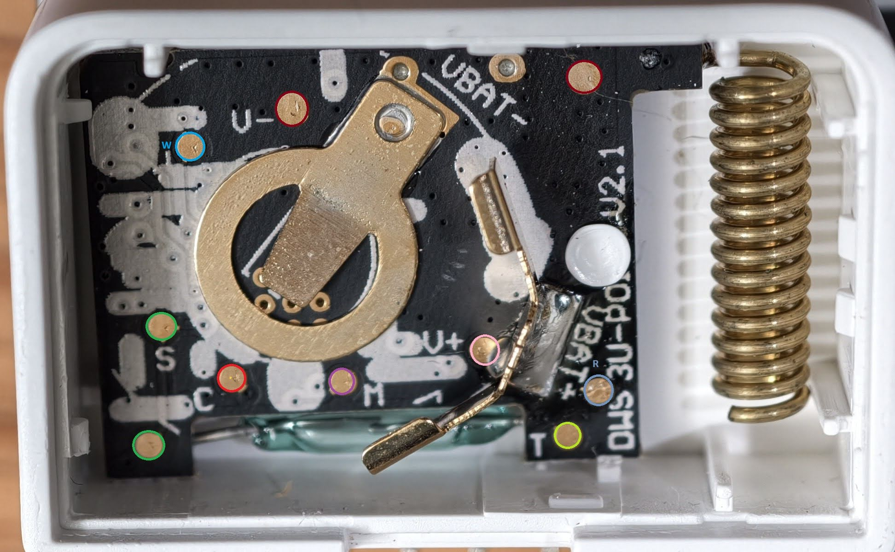
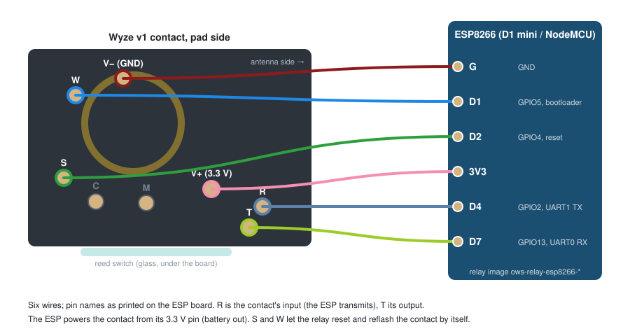

# WyzeSense Relay (`wyzesenserelay`)

Turn an **ESP32-S3**, **classic ESP32 (LOLIN32)**, or **ESP8266 (D1 mini / NodeMCU)** paired with a Wyze Sense v1 contact or motion sensor board into a standalone Wi-Fi IP gateway for [`wyzesense2mqtt-rs`](https://github.com/HclX/wyzesense2mqtt-rs).

## High-Level Concept

Instead of plugging a Wyze Sense USB dongle into your server, a WyzeSense Relay puts a Wi-Fi microcontroller right next to a repurposed Wyze Sense v1 board:

- **Direct Wi-Fi bridge:** The ESP talks to the CC1310 radio over UART (`115200 8N1`) and relays host frames over WebSocket (`/ws/bridge`) to `wyzesense2mqtt-rs`.
- **Multi-relay coverage:** Run as many relays as you need (each with its own MAC), placed wherever sensors need better RF range.
- **Outage buffering:** If Wi-Fi or `wyzesense2mqtt-rs` goes down, up to 32 sensor alarms are buffered in RAM and replayed in order once the link returns.
- **Automatic contact firmware sync:** Each relay carries the OpenWyzeSense gateway firmware (`gateway-contact-v1-app.bin`) and updates its contact board automatically at boot when needed — or you can upload a **Stock Wyze v1.8** dongle dump into a dedicated flash partition and run stock firmware instead.
- **Built-in Provisioning Station (ESP32 / ESP32-S3):** Switch a relay temporarily into **Provisioning station** mode to back up and flash other Wyze Sense v1 sensors using two hand-held probes.

---

## User Guide

### 1. Wiring

Remove the coin-cell battery and solder 7 thin wires (such as strands from a standard Ethernet cable) to the test pads on the Wyze Sense v1 contact board:



| Contact pad (on PCB) | Description | ESP32-S3 | Classic ESP32 (LOLIN32) | ESP8266 (D1 mini / NodeMCU) |
|---|---|---|---|---|
| `V+` (`+`) | 3.3V supply | `GPIO7` *(or `3V3`)* | `GPIO27` *(or `3V3`)* | `3V3` |
| `V-` / `VBAT-` (`-`) | Ground | `GND` | `GND` | `G` (`GND`) |
| `R` | Contact RX (DIO1) | `GPIO17` | `GPIO17` | `D4` (`GPIO2`) |
| `T` | Contact TX (DIO0) | `GPIO18` | `GPIO18` | `D7` (`GPIO13`) |
| `M` | cJTAG TMSC *(recommended)* | `GPIO15` | `GPIO25` | `D5` (`GPIO14`) |
| `C` | cJTAG TCKC *(recommended)* | `GPIO16` | `GPIO26` | `D6` (`GPIO12`) |
| `S` | `RESET_N` *(optional if `+` is on GPIO)* | `GPIO4` | `GPIO4` | `D2` (`GPIO4`) |

> [!NOTE]
> - **RF placement:** Keep **20–30 cm of wire** between the contact board and the ESP, with the contact board's antenna end pointing away from the ESP, its Wi-Fi antenna, and the USB cable for significantly better RF reception.
> - **Unused pads:** `W` (upper-left) is not needed for the relay. See [`docs/guide/pads.md`](docs/guide/pads.md) for the full test-pad colour key.
> - **Powering from GPIO (`GPIO7` / `GPIO27`)** lets the ESP power-cycle the contact board cleanly and enter the debug port or bootloader without needing `S`. Using `3V3` also works as long as `S` is wired.
> - **Wiring `M` and `C` (2-pin cJTAG)** is strongly recommended: it allows automatic recovery of blank/half-flashed boards and is required if you want to run **Stock Wyze v1.8** gateway firmware.
> - **ESP8266:** Leave `D8` (`GPIO15`) unconnected — it must stay low at boot.
> - **Wire colour labels:** Standard Ethernet cable pairs work great for the 7-wire harness. You can record each wire's colour (including striped pairs like `white-orange`, `white-green`, `white-blue`, `white-brown`) in the Web UI so status and probe instructions reference your actual wire colours.

<details>
<summary>Board wiring diagrams (ESP32-S3, LOLIN32, D1 mini)</summary>

- **ESP32-S3:** 
- **Classic ESP32 (LOLIN32):** 
- **ESP8266 (D1 mini / NodeMCU):** 

</details>

---

### 2. Flash the Relay Firmware

#### Option A: Use a Release Archive (Recommended)

1. Download **`wyzesenserelay-<version>.zip`** from the [Releases](https://github.com/HclX/wyzesenserelay/releases) page and unzip it.
2. Make sure `esptool` is available (`pip install esptool`, `pipx install esptool`, or `uv` for `uvx esptool`). On Linux, install the included udev rule once so you don't need `sudo` for USB serial ports:
   ```bash
   sudo cp 72-esp-usb-serial.rules /etc/udev/rules.d/
   sudo udevadm control --reload && sudo udevadm trigger
   ```
3. Plug in your ESP board over USB and run the included flash helper (auto-detects the chip and selects the matching image):
   - **Linux / macOS:**
     ```bash
     ./flash.sh                 # auto-detect port & chip
     ./flash.sh /dev/ttyUSB0    # or specify serial port
     ```
   - **Windows:**
     ```bat
     flash.bat                  & :: auto-detect COM port & chip
     flash.bat COM5             & :: or specify COM port
     ```

   *(Or flash manually with `esptool --chip <esp32s3|esp32|esp8266> write-flash 0x0 <image>.bin`.)*

#### Option B: Build from Source

<details>
<summary>ESP-IDF (ESP32-S3 / Classic ESP32) and PlatformIO (ESP8266) build commands</summary>

```bash
# One-time ESP-IDF toolchain setup (~6 GB into .toolchain/)
tools/toolchain.sh esp-idf

# ESP32-S3 (default)
tools/idf.sh build
tools/idf.sh -p /dev/ttyACM0 flash monitor

# Classic ESP32 (e.g. LOLIN32)
tools/idf.sh -B build-esp32 -D SDKCONFIG=build-esp32/sdkconfig -D IDF_TARGET=esp32 build
tools/idf.sh -B build-esp32 -D SDKCONFIG=build-esp32/sdkconfig -p /dev/ttyUSB0 flash monitor

# ESP8266 (D1 mini / NodeMCU)
tools/pio.sh run -t upload --upload-port /dev/ttyUSB0
```

</details>

---

### 3. First-Time Setup

1. On first boot (with no Wi-Fi configured), the relay starts a setup access point named **`OWS-relay-XXXX`**.
2. Connect your phone or laptop to `OWS-relay-XXXX` and open **`http://192.168.4.1/`**.
3. Open the **Setup** tab:
   - **Wiring:** Optionally assign each pad's wire colour.
   - **Network:** Enter your 2.4 GHz Wi-Fi SSID and password.
   - **Bridge:** Enter your `wyzesense2mqtt-rs` host and port (e.g. `192.168.1.10:8080`, `bridge.enabled: true` in `wyzesense2mqtt-rs`) and bridge token if configured.
   - **Admin password (optional):** Protects setup, OTA, and radio actions (if unset, the bridge token is used when set).
4. Click **Save**. The relay restarts, connects to your Wi-Fi, shuts down the setup AP, and advertises **`http://ows-relay-xxxx.local/`** via mDNS.

---

### 4. Using the Web UI

Once on your network, open `http://<relay-ip>/` (or `http://ows-relay-xxxx.local/`):

- **Status:** View gateway link state, bridge connection count, last log line, and recently heard sensors (MAC, type, last seen, RSSI, battery). Includes buttons to reset the contact board, pause/resume startup firmware sync, and export/import `nv.json` paired-sensor tables.
- **Update:**
  - **Relay firmware (OTA):** Upload a new `ows_relay.bin` / `firmware.bin` to update the relay (and its embedded OpenWyzeSense gateway).
  - **Custom radio firmware:** Flash a custom CC1310 `.bin` directly to the contact board.
  - **Stock gateway firmware (optional):** Upload a 128 KB Wyze v1.8 dongle flash dump (`FLASH.bin`) to store it in the relay's dedicated flash partition, then select **Stock Wyze v1.8** under **Contact firmware** in **Setup**.
- **Setup:** Change Wi-Fi, bridge URL/token, admin password, wire colours, contact firmware (`OpenWyzeSense` vs `Stock Wyze v1.8`), update transport (`auto`, `cjtag`, `sbl`), or **Device role**.
- **Probe (ESP32 / ESP32-S3):** When **Device role** is set to **Provisioning station**, clip `+`/`-` to a target sensor's battery holder (battery removed) and touch the `R`/`T` probes to its pads to **Identify**, **Dump** (save 128 KB flash backup), and **Flash** sensors.

---

### 5. HTTP API Quick Reference

If `admin_pass` (or bridge `token`) is set, include `-u admin:<pass>` (or `Authorization: Bearer <pass>`) on mutating requests:

```bash
curl http://<ip>/api/status                                                # JSON status (chip, board, relay, sensors)
curl -u admin:<pass> -X POST http://<ip>/contact/reset                     # Reset contact board
curl -u admin:<pass> -X POST 'http://<ip>/contact/gwsync?skip=1'           # Pause startup sync (skip=0 resumes)
curl -u admin:<pass> http://<ip>/contact/nv > nv.json                      # Export paired sensors & network NV
curl -u admin:<pass> --data-binary @nv.json http://<ip>/contact/nv         # Import NV without re-pairing
curl -u admin:<pass> -F image=@FLASH.bin http://<ip>/contact/stock         # Store Stock Wyze v1.8 dump
curl -u admin:<pass> -F image=@ows_relay.bin http://<ip>/ota               # OTA update relay firmware
```

---

## Documentation

| Document | Purpose |
|---|---|
| [`docs/guide/pads.md`](docs/guide/pads.md) | Wyze Sense v1 contact board test-pad pinout and colour key |
| [`docs/DESIGN.md`](docs/DESIGN.md) | System architecture, protocol/flash layout, and developer/agent guide |
| [`docs/design/ccfg-rule.md`](docs/design/ccfg-rule.md) | CC1310 CCFG / flash page 31 safety rules |
| [`docs/TODO.md`](docs/TODO.md) | Bench checklist and open tasks |
