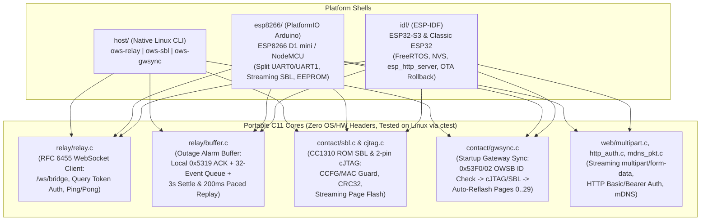

# WyzeSense Relay Architecture & Developer Guide

Technical architecture, hardware design constraints, flash/CCFG safety rules, and host test workflows for `wyzesenserelay` (broken out from `HclX/openwyzesense`).

## Repository Layout

| Path | Purpose |
|---|---|
| `common/` | Shared host protocol framing (`host_proto.c`, `host_proto.h`) and OWS build info block header (`build_info.h`). |
| `relay/` | Portable C11 UART ↔ WebSocket frame relay (`relay.c`), POSIX/lwIP TCP socket adapter (`sock_posix.c`), and outage ring buffer (`buffer.c`). |
| `contact/` | Portable C11 CC1310 2-pin cJTAG IEEE 1149.7 OSCAN1 flash programmer (`cjtag.c`), ROM serial bootloader client (`sbl.c`, including `sbl_stream_*`), startup gateway sync (`gwsync.c`), stock gateway partition packer/verifier (`stock_image.c`), and live NV export/import (`gwnv.c`). |
| `web/` | Portable C11 HTTP Basic/Bearer auth (`http_auth.c`), streaming `multipart/form-data` parser (`multipart.c`), mDNS responder (`mdns_pkt.c`), and single-file Web UI (`web/index.html`). |
| `rig/` | Portable C11 contact test-rig signal controller (`rig.c`). |
| `host/` | Native Linux host CLIs (`ows-relay`, `ows-sbl`, `ows-gwsync`) and unit test binaries (`test_relay`, `test_buffer`, `test_cjtag`, `test_sblprobe`, `test_gwnv`, `test_stock_image`, `test_multipart`, `test_http_auth`, `test_mdns`, `test_rig`). |
| `idf/` | ESP-IDF v5.5.6 firmware for ESP32-S3 and classic ESP32 (`idf/main/pins.h`, `idf/main/web.c`, `idf/partitions.csv`). |
| `esp8266/` | PlatformIO Arduino firmware (`d1_mini` / NodeMCU) wrapping the same portable `relay/`, `contact/`, `web/`, and `common/` cores. |
| `firmware/` | Embedded CC1310 OpenWyzeSense gateway firmware (`gateway-contact-v1-app.bin`). |
| `tools/` | Build, lint, coverage, toolchain, and SBL helper scripts (`idf.sh`, `pio.sh`, `lint.sh`, `coverage.sh`, `toolchain.sh`, `uart_sbl.py`, `image_id.py`, `stock_partition.py`, `wiring_svg.py`). |
| `tests/` | Pytest suite covering `ows-sbl`, `ows-gwsync`, `uart_sbl.py`, `image_id.py`, and `stock_partition.py`. |

---

## Core Architecture



### 1. Relay & Outage Buffer (`relay/`)

- **Transparent UART ↔ WebSocket Bridge (`relay/relay.c`):** Connects to `ws://<host>:<port>/ws/bridge?device=<esp32|esp8266>-<mac>[&token=<token>]`, performs RFC 6455 upgrade, encapsulates raw UART bytes in binary WebSocket frames (`OP_BIN`), answers `OP_PING` with `OP_PONG`, and reconnects every `5000 ms`.
- **Low-latency Wi-Fi & liveness:** Disables Wi-Fi modem power-save (`WIFI_PS_NONE` / `WIFI_NONE_SLEEP`), sets `TCP_NODELAY = 1`, and sends client `OP_PING` frames (`30 s` interval, `10 s` `PONG` timeout) so silent NAT drops engage the outage buffer instead of hanging.
- **Outage buffer (`relay/buffer.c`):**
  - While `RELAY_DOWN`, `RELAY_HANDSHAKE`, during the `3000 ms` post-connect settle window, or while `b->count > 0`, incoming `0x5319` (`Alarm`) packets receive a local `HOST_ACK` (`AA 55 53 19 FF 02 6A`) and are queued in a 32-slot FIFO ring buffer (evicting oldest on overflow).
  - Once connected for `3000 ms`, `buffer_tick()` replays one queued alarm every `200 ms`, swallowing matching server ACKs (`acks_to_keep`) and rebasing `1970` cold-boot timestamps on `0x5333` (`HOST_TIME_SYNC`).
  - `buffer_from_server()` filters remote `0x4312` / `OWS_SUB_ENTER_SBL` frames.

### 2. Contact Sync & Bootloader (`contact/`)

- **Startup sync (`gwsync.c`):** Unless `skip_gwsync` is set (`POST /contact/gwsync?skip=1`), queries the contact's build info (`0x53F0` sub-ID `0x02` `OWS_SUB_BUILD_INFO`) and MAC (`0x4304`) before starting the relay. If the image ID differs or the contact does not answer:
  1. In `auto` (default) or `cjtag` mode, attempts 2-pin cJTAG (`M`/`C`) flash first.
  2. Falls back to ROM serial bootloader (`sbl.c` `sbl_stream_*` page-by-page streaming, zero 120 KB RAM buffer): tries 4-wire software SBL (`0x53F0` sub-ID `0x05` `OWS_SUB_ENTER_SBL`) first, then hardware `R` (DIO1 backdoor `0xC5FE01C5`) + `S` / power-cycle entry.
- **Image IDs:** Computed from code hash (`tools/image_id.py`), so relay OTA updates that do not change `gateway-contact-v1-app.bin` skip reflashing the CC1310.
- **Live NV (`gwnv.c`):** Zero-ladder NV JSON export/import over `0x53F0` sub-IDs `0x04` / `0x06`.
- **Non-blocking buffered UART reads (`contact_uart_read()`):** Waits up to `timeout_ms` for the first byte, then drains whatever is queued in the hardware FIFO (`uart_get_buffered_data_len()`) with timeout `0`, keeping full-image SBL flashes around `~8.4 s` on ESP32.

### 3. Stock Wyze v1.8 Gateway Partition (`contact/stock_image.c`)

Proprietary stock firmware is **never** embedded in the repository or any relay app binary. Instead, the user supplies a dump stored in a dedicated flash area that survives `/ota` updates:

- **Partition location:**
  - ESP32 / ESP32-S3 (`idf/partitions.csv`): `gwstock` data partition (`subtype 0x40`, offset `0x320000`, size `0x20000`), memory-mapped via `esp_partition_mmap` (and registered at runtime via `esp_partition_register_external` on relays OTA-updated from pre-`gwstock` partition tables).
  - ESP8266 (`esp8266/src/main.cpp`): start of unused `_FS_start` area (`0x300000` on 4 MB `d1_mini` per `eagle.flash.4m1m.ld`).
- **Stored format (`contact/stock_image.h`):** 48-byte `OWSSTOCK` header (`magic = "OWSSTOCK"`, `format = 1`, `len = 0x1EFA8`, `sha256[32]`) + `0x1EFA8`-byte packed image (pages 0–29 + page 31 code `0x1F000..0x1FFA7`, excluding page 30 NV and 88-byte CCFG `0x1FFA8..0x1FFFF`). Accepted only if SHA-256 matches `ab9c235bbce832a7dc74d67092199ba4108d8d24a33209c781bf483b85684ea0`.
- **Flashing & identity:** Requires cJTAG (`M`/`C`) because the ROM bootloader cannot write page 31. `gwsync` preserves page 30 and writes page 31 code via `cjtag_write_page31_code`. Because stock CC1310 has no CH554 USB bridge, `buffer.translate_sync` (`ows-relay --stock`) translates `0x43xx` ↔ `0x53xx` sync requests/ACKs, and `gwsync` writes the CCFG MAC into stock NV (`0x5308`).
- **Pre-population on PC:** `uv run python tools/stock_partition.py FLASH.bin build/gwstock.bin`, then `esptool.py write_flash 0x320000 build/gwstock.bin` (ESP32/S3) or `0x300000` (ESP8266).

### 4. CCFG & Page 31 Safety Rules

See [`docs/design/ccfg-rule.md`](design/ccfg-rule.md) for the full specification:
- Never disable the debug port, set protection bits, alter `IMAGE_VALID_CONF`, make the bootloader unreachable, or overwrite a dongle's page 31 CCFG.
- Every page-31 writer must go through `cjtag_write_page31_code` (`ccfg_safe` check, double-read, full-page verify, rollback on failure).
- Program-only fills of blank CCFG MAC bytes are allowed via `POST /contact/ccfg_mac` (`cjtag_fill_ccfg_mac`, no erase).
- Bootloader backdoor configuration is inspectable/settable via `GET/POST /contact/bootloader` (`cjtag_set_backdoor`).

### 5. Provisioning Station (`role = 2`, ESP32 / ESP32-S3)

Mutually exclusive with relay mode (restarts to switch):
- Uses `+` / `-` clips (switched supply + GND) and two hand-held probes (`R`, `T`).
- Supports **cJTAG** (`M`/`C`, auto-polarity), **Bootloader T/R** (`sbl2`, detects probe contact after 200 ms, tests both polarities across power-up), and **W/S** identification.
- Enforces **Identify** before **Dump** or **Flash**; dumps 128 KB flash + FCFG1; flashes pages 0–29 (page 30 only with `nv=wipe`, page 31 never).

### 6. Hardware Pin & Strap Constraints (`idf/main/pins.h`, `esp8266/src/main.cpp`)

- **UART RX pull-up:** Both ESP-IDF and ESP8266 enable internal pull-up on UART RX (`T`) so an unprogrammed/floating contact board does not flood noise bytes during boot waits.
- **Supply isolation when off:** While contact `+` power GPIO is off, UART/reset lines are not driven high to avoid phantom-powering the CC1310 through I/O clamp diodes.
- **ESP32 straps:** Flash pins (`6–11`), consoles (`1/3`), and straps (`0, 2, 5, 12, 15`) are left untouched (`GPIO5` drives LOLIN32 blue LED; `GPIO12` high at boot selects 1.8 V flash).
- **ESP32-S3 pins:** USB (`19/20`), flash (`26–32`), consoles (`43/44`), and straps (`0, 3, 45, 46`) are left untouched.
- **ESP8266 constraints:** `D8` (`GPIO15`) must remain low at boot; UART1 TX (`D4`/`GPIO2`) drives contact `R` (idles high, as required at boot), and `Serial.swap()` moves UART0 RX to `D7` (`GPIO13`) for reliable 115200 RX with Wi-Fi active.
- **Board reporting (`GET /api/status`):** Reports `"chip"` (`"ESP32"`, `"ESP32-S3"`, `"ESP8266"`) and `"board"` (`OWS_BOARD` / `CONFIG_OWS_BOARD`, defaulting to `"devkit"` on S3, `"lolin32"` on ESP32, `${this.board}` on ESP8266).

### 7. Classic ESP32 Battery Sleep-Current Rig (`rig/`)

- On classic ESP32 (`LOLIN32`), moving contact `+` to `GPIO32` (ADC1 ch 4) enables `/rig` (`POST /rig?enable=1`, `measure=1`, `GET /api/rig`) to measure CC1310 sleep current (`sleep_na`, `wakes`, `holds`) by pulsing 10 µs refills across `3.00 V → 2.95 V` on decoupling capacitance.

### 8. Security & Fallback SoftAP Lifecycle (`web/http_auth.c`)

- Once `admin_pass` (or bridge `token`) is configured, mutating HTTP endpoints require HTTP Basic (`admin:<pass>`) or `Authorization: Bearer <pass>`. `GET /setup` never echoes secrets.
- Fallback SoftAP (`OWS-relay-XXXX`) opens after STA reconnect backoff (`~90–120 s`), tears down immediately on `GOT_IP`, and closes after 15 minutes idle while continuing STA retries.

---

## Development, Testing & CI

```bash
# 1. Host C library + unit tests (10 CTest targets)
cmake --preset host
cmake --build --preset host
ctest --preset host --output-on-failure

# 2. Python SBL / gwsync / stock_partition tests
uv run pytest -q

# 3. Formatters & static analysis (clang-format, clang-tidy, ruff, shfmt, shellcheck)
tools/lint.sh

# 4. Firmware builds
tools/idf.sh build                                                                # ESP32-S3
tools/idf.sh -B build-esp32 -D SDKCONFIG=build-esp32/sdkconfig -D IDF_TARGET=esp32 build  # ESP32
tools/pio.sh run                                                                  # ESP8266
```
