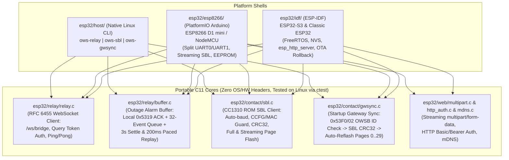

# The relay's architecture

Moved here from openwyzesense's `docs/design/DESIGN.md` §8 when the relay became its own repository (2026-11-08).
Paths below are as they were there: `esp32/<dir>` is now `<dir>` at this repository's root, `esp32/host` is `host/`,
`firmware/common/host_proto.*` is `common/`.

## Network / IP Gateway & ESP32 / ESP8266 Relay Architecture (`esp32/`)

### 1 Motivation, Supported Boards & Hardware Wiring
To eliminate the range and placement limits of a single USB dongle, OpenWyzeSense pairs a `wyze_contact_v1` board running `gateway-contact-v1` with a Wi-Fi microcontroller (**ESP32-S3**, **classic ESP32 LOLIN32**, or **ESP8266 Wemos D1 mini / NodeMCU**) to form a standalone Wi-Fi IP Gateway (`esp32/README.md`):

| `wyze_contact_v1` Pad | CC1310 Signal | ESP32-S3 (`esp32/idf/`) | Classic ESP32 (LOLIN32, `IDF_TARGET=esp32`) | ESP8266 (`esp32/esp8266/`, D1 mini / NodeMCU) | Purpose |
|---|---|---|---|---|---|
| `+` | `VDDS` (`3.3 V`) | `3V3` | `3V3` | `3V3` | Mains-powered 3.3 V supply (radio RX is always on; never `5V`) |
| `-` | `GND` | `GND` | `GND` | `GND` | Common ground |
| `T` | `DIO0` (`UART0_TX`) | `GPIO18` (`UART1_RX`, pull-up) | `GPIO18` (`UART1_RX`, pull-up) | `D7` / `GPIO13` (`UART0_RX` swapped) | `55 AA` packets & SBL replies from CC1310 to ESP (115200 8N1) |
| `R` | `DIO1` (`UART0_RX`) | `GPIO17` (`UART1_TX`) | `GPIO17` (`UART1_TX`) | `D4` / `GPIO2` (`UART1_TX`) | `AA 55` packets & SBL commands from ESP to CC1310 (115200 8N1) |
| `S` | `RESET_N` (int pull-up) | `GPIO4` (open-drain) | `GPIO4` (open-drain) | `D2` / `GPIO4` (open-drain) | Pulled low (`20 ms`) to hardware-reset the CC1310 |
| `W` | `DIO10` (ext pull-up) | `GPIO5` (open-drain) | `GPIO23` (open-drain; `GPIO5` is strap/LED, `GPIO6–11` SPI flash) | `D1` / `GPIO5` (open-drain) | Held low across `S` reset to enter CC1310 ROM Serial Bootloader |

#### Key Hardware & Electrical Design Rules Discovered on the Bench
1. **ESP8266 `GPIO15` (`D8`) Boot-Strap Trap & Split-UART Solution (`esp32/esp8266/src/main.cpp`)**:
   - On ESP8266, `Serial.swap()` remaps `UART0` to `GPIO13` (`D7`, RX) and `GPIO15` (`D8`, TX). However, the ESP8266 boot ROM samples `GPIO15` at power-up and refuses to boot from SPI flash if `GPIO15` is pulled high (`SDIO` boot mode)—and the CC1310's `R` (`DIO1`) UART RX pin idles high (`3.3 V`). Meanwhile, software serial (`SoftwareSerial`) drops ~20% of `Inquiry` packets when Wi-Fi interrupts are active.
   - **Solution**: The ESP8266 firmware swaps `UART0` so **hardware RX is on `D7` (`GPIO13`)** (receiving from contact `T`), leaves `D8` (`GPIO15`) unconnected, and transmits to contact `R` using **`UART1`'s dedicated hardware TX on `D4` (`GPIO2`, `Serial1`)**.
2. **ESP UART RX Internal Pull-Up (`esp32/idf/main/contact.c`)**:
   - While the CC1310 is held in reset, in pre-sync ROM bootloader mode, or holds a half-written image, its `T` (`DIO0`) pad floats. Without an internal pull-up enabled on the ESP's UART RX pin (`gpio_pullup_en()`), floating line noise is sampled as continuous framing bytes (`00 ff 00 fe ...`), corrupting SBL sync and relay parsing.
3. **Open-Drain `W` and `S` Control & Hardware Reset Exit**:
   - Because the contact board pulls `W` (`DIO10`) and `S` (`RESET_N`) up to `3.3 V`, the ESP drives both pins open-drain (`GPIO_MODE_OUTPUT_OD` on ESP32; switching between `INPUT` and `OUTPUT LOW` on ESP8266) so it never fights the contact's pull-ups.
   - After SBL operations complete, the relay always exits the bootloader via a hardware `S` pulse (`contact_reset()`) rather than the SBL `CMD_RESET (0x25)` command, which leaves the CC1310 in a halted state after debug/SBL sessions.
4. **Non-Blocking Buffered UART Reads (`contact_uart_read()`)**:
   - Calling ESP-IDF's `uart_read_bytes(cap, timeout)` waits for the full `cap` bytes or the full timeout on every short SBL ACK (causing a single 4 KB page flash to take `49 s` on LOLIN32). Instead, `contact_uart_read()` waits up to `timeout_ms` for the *first* byte and then immediately drains whatever is queued in the hardware FIFO (`uart_get_buffered_data_len()`) with timeout `0`, flashing the entire gateway image in `~8.4 s`.

### 2 Architecture of `esp32/`: Shared Portable C Cores + Target Shells

1. **Transparent UART ↔ WebSocket Bridge (`esp32/relay/relay.c`)**:
   - Portable, allocation-free C state machine shared across ESP-IDF (`esp32/idf/`), ESP8266 (`esp32/esp8266/`), and Linux (`ows-relay`).
   - Connects to `wyzesense2mqtt-rs` at `ws://<host>:<port>/ws/bridge?device=<esp32|esp8266>-<mac>[&token=<token>]` (passing WebSocket authentication in the `?device=<name>&token=<token>` query string to match `wyzesense2mqtt-rs`), performs the RFC 6455 HTTP/1.1 `101 Switching Protocols` upgrade, encapsulates raw UART bytes in binary WebSocket frames (`OP_BIN`), answers `OP_PING` with `OP_PONG`, and reconnects automatically every `5000 ms` (`RELAY_RECONNECT_MS`).
   - **Low-Latency Wi-Fi & Liveness Requirements (`TASK-08`)**: Because the CC1310 gateway retries un-ACKed `0x53` UART frames every `160 ms` (`HOST_RETRY_MS`) and sensor OTA blocks (`0x53F1 0x11` `OWS_SUB_OTA_NEED` → `0x53F0 0x12` `OWS_SUB_OTA_DATA`) stream interactively on sensor polls, the ESP shell disables Wi-Fi modem power-save (`esp_wifi_set_ps(WIFI_PS_NONE)` / `WiFi.setSleepMode(WIFI_NONE_SLEEP)`), sets `TCP_NODELAY = 1` on the WebSocket socket, and sends periodic client-initiated WebSocket `OP_PING` frames (`30 s` interval with a `10 s` `PONG` timeout) so silent NAT drops or server crashes immediately transition to `RELAY_DOWN` and engage the outage buffer instead of hanging in `RELAY_OPEN`.
2. **Network-Outage Alarm Buffer (`esp32/relay/buffer.c`, `buffer.h`)**:
   - Sits between the gateway UART and `relay.c` so sensor events are not lost when Wi-Fi or `wyzesense2mqtt-rs` restarts:
     - **While `RELAY_OPEN` (after replay settle AND with `b->count == 0`)**: Bytes pass straight through in both directions (`buffer_from_server()` filters remote `0x4312` / `OWS_SUB_ENTER_SBL` frames per §6.6).
     - **While `RELAY_DOWN` / `RELAY_HANDSHAKE`, during the `3 s` post-connect settle window, OR while `b->count > 0` (`TASK-02`)**: `buffer_from_gateway()` parses `55 AA` packets from the CC1310. When a `0x5319` (`Alarm`) packet arrives, the buffer immediately sends a local `HOST_ACK` (`AA 55 53 19 FF 02 6A`) back to the CC1310 UART so the gateway stops retrying, and appends the packet to the **tail** of the 32-slot FIFO ring buffer (`BUFFER_ALARMS = 32`, `BUFFER_ALARM_MAX = 80` bytes per packet; if full, the oldest alarm is evicted and `dropped_total` increments). Continuing to queue newly arriving `0x5319` alarms while `b->count > 0` guarantees **strict chronological FIFO ordering** (preventing a live "door closed" packet from overtaking a still-draining buffered "door opened" packet and inverting Home Assistant state).
     - **Replay, Duplicate-ACK Suppression & Post-Boot Timestamp Rebasing (`TASK-02`)**: Once the WebSocket connection has remained open for **`3000 ms`** (`BUFFER_REPLAY_AFTER = 3000`), `buffer_tick()` replays one queued alarm every **`200 ms`** (`BUFFER_REPLAY_EVERY = 200`). For each replayed alarm, `acks_to_keep` increments (with a `2 s` safety expiry if a server ACK is ever dropped), and `buffer_from_server()` swallows that many incoming `AA 55 53 19 FF` server ACKs. If the ESP + CC1310 cold-booted during a power/Wi-Fi outage (`gw->clock_ms < 2020-01-01`), `buffer.c` records the relative offset and rebases buffered `1970` alarm timestamps as soon as the server sends `0x5333` (`HOST_TIME_SYNC`) before replaying them.
3. **Portable CC1310 ROM SBL Client (`esp32/contact/sbl.c`)**:
   - Implements the complete CC1310 ROM Serial Bootloader protocol (`CMD_AUTO_BAUD 0x5555`, `CMD_PING 0x20`, `CMD_DOWNLOAD 0x21`, `CMD_GET_STATUS 0x23`, `CMD_SEND_DATA 0x24`, `CMD_SECTOR_ERASE 0x26`, `CMD_CRC32 0x27`, `CMD_GET_CHIP_ID 0x28`, `CMD_MEMORY_READ 0x2A`) in portable C.
   - **Safety Invariants**: Before erasing or writing a single page, `sbl_connect()` reads the CC1310's CCFG (`0x50003FD8` and `0x50003FCC`), verifies that the ROM bootloader and active-low backdoor remain enabled (`BL_CONFIG == 0xC5FE0AC5`), validates the 8-byte ASCII MAC at `0x1FFCC` (and optionally matches `expect_mac`), and enforces `addr + len <= 0x1E000` (Pages 0–29 only; Page 30 `OWNV` is only erased via explicit `sbl_write_nv()`, and Page 31 `CCFG` is unreachable).
   - **Unified Streaming Flash (`sbl_stream_begin/step/end()`, `TASK-08`)**: Both ESP8266 (`~40 KB` heap) and ESP32/ESP32-S3 stream each 4 KB page via `sbl_stream_*()` during `gwsync` and `/contact/flash` HTTP uploads without requiring a contiguous 120 KB heap allocation.
4. **Startup Self-Updating Gateway Sync (`esp32/contact/gwsync.c`, `esp32/gateway_image.py`, `#76`)**:
   - At build time, `esp32/gateway_image.py` builds `gateway-contact-v1-app.bin` (padded to 4-byte words) and embeds it into both the ESP-IDF image (`target_add_binary_data`) and the ESP8266 image (`esp32/esp8266/embed.py` `PROGMEM`).
   - At every relay boot (`gwsync_run()`), before opening the WebSocket bridge:
     1. Resets the contact (`contact_reset()`), waits `BOOT_MS = 300`, and queries `OWSB` build info (`0x53F0` sub-ID `0x02` `OWS_SUB_BUILD_INFO`, `part = 0`, up to `TRIES = 3` attempts × `600 ms`).
     2. **Fast Path (`GWSYNC_SAME`)**: If the contact replies with a valid `OWSB` block whose 8-byte `id` matches the embedded image's `OWSB` `id`, `gwsync` also queries `0x4304` (`GetMAC`) so `contact_mac` is populated on normal boots, and finishes with zero flash writes.
     3. **Silent Contact Fallback (SBL CRC-32 Check)**: If the contact does not answer (e.g., blank flash, stock sensor firmware, or older gateway firmware), `gwsync` enters the ROM SBL (`OWS_SUB_ENTER_SBL` first, falling back to `contact_enter_bootloader()`), runs `sbl_connect()`, and checks the chip's `CMD_CRC32` over the embedded image size. If the CRC-32 already matches, it resets the contact back to run mode without reflashing.
     4. **Automatic Reflash (`GWSYNC_UPDATED`)**: If the `OWSB` `id` or SBL `CRC-32` differs (and auto-sync is not paused by user safe-mode override, `TASK-17`), `gwsync` streams the embedded `gateway-contact-v1-app.bin` into Pages 0–29 via `sbl_stream_*()` (preserving Page 30 `OWNV` sensor pairings and Page 31 `CCFG`), resets the contact, and re-queries `OWSB` + `0x4304` (`GetMAC`) to confirm the new `id` is live.

### 3 Provisioning, Security, Web UI & OTA Rollback (`esp32/web/`)
1. **Wi-Fi Provisioning & Secured Fallback Captive AP (`TASK-01`)**:
   - Settings (`ssid`, `pass`, `url`, `token`, `admin_pass`) are stored in NVS (`esp32/idf/main/settings.c`) or EEPROM (`esp32/esp8266/src/main.cpp`).
   - **Unprovisioned (`ssid` empty)**: Immediately starts the setup AP `OWS-relay-XXXX` at `http://192.168.4.1/`.
   - **Provisioned (`ssid` set)**: Retries STA connection with backoff before opening the fallback AP (so router reboots after a power outage do not prematurely broadcast an open AP), **and immediately tears down the softAP (`WIFI_MODE_STA` / `WiFi.softAPdisconnect(true)`) whenever STA acquires an IP (`IP_EVENT_STA_GOT_IP`)** so `OWS-relay-XXXX` never remains open permanently on the air. Also advertises `ows-relay-xxxx.local` via mDNS (`TASK-17`).
2. **HTTP Authentication & Endpoints (`esp32/web/index.html`, `http_auth.c`, `TASK-01`, `TASK-14`, `TASK-17`)**:
   - When provisioned (a WebSocket `token` or `admin_pass` is configured), all state-mutating HTTP endpoints (`POST /setup`, `POST /ota`, `POST /contact/reset`, `POST /contact/flash`, `POST /contact/gwsync`, `POST /contact/nv`, and `/debug/uart`) require HTTP Basic or Bearer authentication (`http_auth.c`), and `GET /setup` never echoes plaintext secrets.
   - `GET /` & `GET /api/status`: Serves the single-page status and control dashboard (polled every `2 s`) with relay state, WebSocket/UART/outage-buffer counters, per-sensor diagnostics (`mac`, `type`, `seen_s`, `rssi`, `bat_mv`), `gwsync` progress/skip state, running `OWSB` version/ID, and UI buttons/forms for CC1310 reset, CC1310 flash, `gwsync` safe-mode toggle, NV JSON import/export, and ESP OTA.
   - `POST /setup`: Saves Wi-Fi credentials, `ws://host:port/ws/bridge` URL/token, and optional `admin_pass`, then restarts.
   - `POST /contact/reset` & `POST /contact/flash?mac=...&nv=wipe&keep=1`: Resets or streams a CC1310 image over SBL (`keep=1` pauses startup `gwsync` so a custom image is preserved across reboots).
   - `POST /contact/gwsync?skip=0|1`: Pauses (`skip=1`) or resumes (`skip=0`) automatic startup `gwsync`.
   - `POST /contact/nv` & `GET /contact/nv`: Imports/exports `nv.json` sensor pairings via `OWS_SUB_NV_IMPORT` (`sub_id = 0x06`, `CLEAR`/`SET_NET`/`ADD_SENSOR`/`GET_SENSOR`) for zero-ladder migration from a USB dongle (`TASK-14`).
   - `POST /ota`: Streams an ESP32/ESP8266 firmware update (`ows_relay.bin`) over Wi-Fi, with automatic ESP-IDF slot rollback (`ESP_OTA_IMG_PENDING_VERIFY`) if the new build fails to reach the network.
   - `GET /debug/uart` (`#ifdef OWS_DEBUG_UART` on ESP8266 / debug config on ESP-IDF): Authenticated raw UART diagnostic ring-buffer dump, compiled out of default release builds.

---

