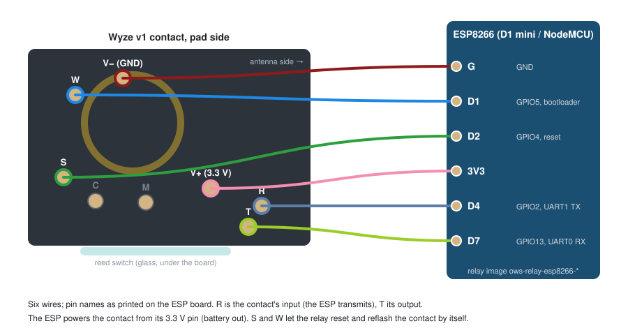

# Level 4: build a Wi-Fi gateway (v1 contact board + ESP)

A v1 contact board running our gateway firmware, wired to an ESP32, ESP32-S3 or ESP8266 board that relays it to
wyzesense2mqtt-rs over Wi-Fi. It works like a dongle, but goes anywhere with Wi-Fi and USB power, and you can have
several of them: one per floor, or one in the garage. Dead (zero-MAC) contacts are ideal for this, because a gateway
does not need the sensor's MAC to be working.

While Wi-Fi or wyzesense2mqtt-rs is down, the relay keeps the sensors' alarms (up to 32) and delivers them when the
link is back. Its web page shows each sensor's signal strength, battery and last report.

**You need:**

- a v1 contact sensor (its board becomes the gateway's radio; the battery is not used);
- one of these ESP boards: an **ESP32-S3 DevKit**, a **classic ESP32 (LOLIN32)**, or an **ESP8266 (D1 mini or
  NodeMCU)**, and a USB power supply for it;
- 5 wires, soldered to the contact's pads (this is permanent);
- the LaunchPad setup from [level 2](2-revive-contact.md), once, to prepare the contact board;
- `esptool`, Espressif's flashing tool, for the ESP's first flash: `pip install esptool` (or `pipx install esptool`);
- from the release: `ows-flash-linux-x86_64-<version>`, `ows-gateway-contact-v1-<version>.bin`, the relay images for
  your ESP board (table below), `71-ti-xds110.rules` and `72-esp-usb-serial.rules`;
- [wyzesense2mqtt-rs](https://github.com/HclX/wyzesense2mqtt-rs) running somewhere on your network.

| ESP board | First flash | Later updates |
|---|---|---|
| ESP32-S3 | `ows-relay-esp32s3-full-<version>.bin` | `ows-relay-esp32s3-ota-<version>.bin` |
| classic ESP32 (LOLIN32) | `ows-relay-esp32-full-<version>.bin` | `ows-relay-esp32-ota-<version>.bin` |
| ESP8266 (D1 mini, NodeMCU) | `ows-relay-esp8266-<version>.bin` | the same file |

## 1. Prepare the contact board (once, on the LaunchPad)

Wire the contact to the LaunchPad as in [level 2, step 2](2-revive-contact.md#2-wire-it-to-the-launchpad), battery
out, and run:

```
./ows-flash v1 provision --gateway --app ows-gateway-contact-v1-<version>.bin
```

As for a sensor, it backs the board up first (`backups/contact_v1/<MAC>/`), then writes the gateway firmware and
enables the board's serial bootloader on the `R` pad. From then on, the ESP keeps the board's firmware up to date by
itself, and the LaunchPad is not needed again.

## 2. Wire it to the ESP

Five wires. The ESP powers the contact board from its 3.3 V pin. `R` is the contact's serial input (the ESP's TX, and
the board's bootloader backdoor), and `T` its output (the ESP's RX). `S` (reset) lets the ESP reset and reflash the
board.

### ESP32-S3


| Contact pad | ESP32-S3 |
|---|---|
| `V+` / `V−` | 3V3 / GND |
| `R` | GPIO17 |
| `T` | GPIO18 |
| `S` | GPIO4 |

### Classic ESP32 (LOLIN32)


| Contact pad | LOLIN32 |
|---|---|
| `V+` / `V−` | 3V / GND |
| `R` | 17 |
| `T` | 18 |
| `S` | 4 |

Leave GPIO0, 2, 5, 12 and 15 free: they decide how the ESP32 starts.

### ESP8266 (D1 mini, NodeMCU)



| Contact pad | D1 mini / NodeMCU |
|---|---|
| `V+` / `V−` | 3V3 / G |
| `R` | D4 |
| `T` | D7 |
| `S` | D2 |
| `M` | D5 (optional: updates through the debug port, and setting the bootloader pin) |
| `C` | D6 (with `M`) |

Nothing goes on D8: the ESP8266 does not start if D8 is pulled high.

## 3. Flash the ESP

Plug the ESP board into the PC with USB (the contact board can stay wired) and write the first-flash image. The serial
port is usually `/dev/ttyACM0` for an ESP32-S3 and `/dev/ttyUSB0` for the others:

```
esptool.py --chip esp32s3 --port /dev/ttyACM0 write_flash 0x0 ows-relay-esp32s3-full-<version>.bin
esptool.py --chip esp32   --port /dev/ttyUSB0 write_flash 0x0 ows-relay-esp32-full-<version>.bin
esptool.py --chip esp8266 --port /dev/ttyUSB0 write_flash 0x0 ows-relay-esp8266-<version>.bin
```

(Newer esptool versions are called `esptool` and accept `write-flash`.) If esptool cannot connect, hold the board's
BOOT button while it starts. The first flash also erases the relay's settings.

## 4. Set it up

1. Turn on bridged gateways in wyzesense2mqtt-rs: `bridge.enabled: true` in its config, and optionally a token
   (`bridge.auth_token`). See [its README](https://github.com/HclX/wyzesense2mqtt-rs#-remote-dongle-bridge).
2. Power the ESP. Unconfigured, it opens a Wi-Fi access point named `OWS-relay-XXXX`. Join it and open
   http://192.168.4.1/setup.
3. Enter your Wi-Fi network and password, the bridge address `ws://<wyzesense2mqtt-rs host>:8080/ws/bridge`, the token
   if you set one, and an admin password for the relay's page (recommended; it guards the update and flash buttons).
4. It restarts onto your Wi-Fi and closes the access point. Its page is then at `http://ows-relay-xxxx.local/` (the
   same four characters as the access point, in lower case), or at the address your router gave it.

At every start, before relaying anything, the relay checks the contact board's firmware against the gateway firmware
it carries, and updates the board if they differ (about 30 seconds). It then shows up in wyzesense2mqtt-rs as a
gateway (a dongle), and you pair sensors with it as with any dongle.

Place it centrally: its radio reaches less far than the USB dongle's. For a large house, use more than one (see
roaming in [level 5](5-wyzesense2mqtt.md)).

## Moving sensors from a dongle

A dongle's paired sensors can move to the relay without re-pairing: the relay takes over the dongle's network,
including its identity, and the sensors never notice.

1. Get the dongle's `nv.json`: from its backup directory ([level 1](1-dongle.md)), or for a stock dongle
   `./ows-flash backup backups/dongle-1` and then `./ows-flash nv export backups/dongle-1/flash.bin -o nv.json`.
2. On the relay's page, **Import `nv.json`**.
3. **Unplug the old dongle** (or put it on a different network). Two gateways with the same identity both answer every
   sensor, and their answers collide, unless roaming is on ([level 5](5-wyzesense2mqtt.md)).

The export lists any sensor it cannot carry over (two sensors sharing one address in the stock table): pair those
again.

## Updating

Upload the update image on the relay's page (**Update**), or let wyzesense2mqtt-rs do it (**Update relay** in the
relay's Actions dialog, [level 5](5-wyzesense2mqtt.md)). The relay restarts, brings the contact board's firmware up to
date by itself, and reconnects. On an ESP32 or ESP32-S3, an update that cannot reach the network again is rolled back
at the next restart.

The relay's page also has maintenance buttons: reset the contact board, pause the start-up firmware check, export and
import `nv.json`, and flash a different image onto the contact board.
