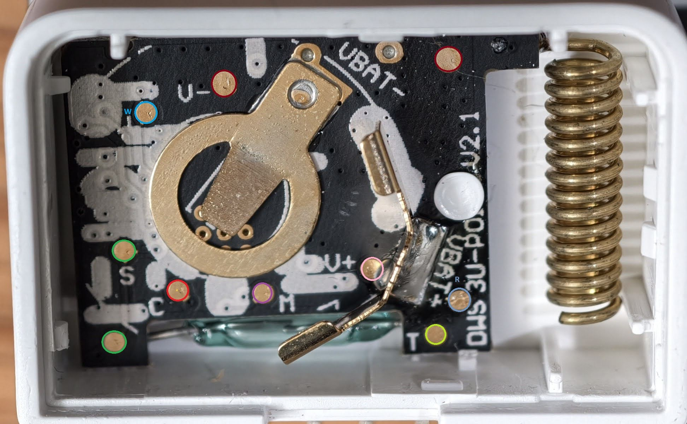

# Test pads

The photos circle each pad in its signal's colour; the wiring diagrams in this guide use the same colours.

## v1 contact sensor

The pads are on the battery side of the board (battery out). Labels are printed next to most of them.

| Pad | Colour | Signal | Used for |
|---|---|---|---|
| `V+` | pink | 3.3 V supply | power from the LaunchPad or the ESP (battery out) |
| `V−` | dark red | ground | |
| `M` | purple | JTAG TMSC | flashing with the LaunchPad (levels 2-4) |
| `C` | red | JTAG TCKC | flashing with the LaunchPad |
| `S` | green | reset (RESET_N) | flashing with the LaunchPad; the ESP's reset line |
| `R` | grey-blue | the chip's serial input and bootloader backdoor (DIO1) | console (level 3); the ESP's TX and bootloader entry (level 4) |
| `T` | yellow-green | the chip's serial output (DIO0) | console; the ESP's RX |
| `W` | blue | DIO10 (factory test input, pulled up) | |

A second green pad (bottom left) and a second dark-red pad (top right) carry the same signals as `S` and `V−`;
use whichever is easier to reach.

The reed switch (the glass tube along the bottom edge, under the board) connects the chip's input DIO7 to ground when
a magnet is near; the DIY sensors in [level 3](3-contact-sensor.md#diy-sensor-types) replace it. The button is on DIO11
and the LED on DIO9; neither has a pad.

## Wyze USB dongle

None of the levels needs the dongle's pads: it is flashed over its own USB port ([level 1](1-dongle.md)). They are
shown here for reference and repairs. Its CC1310 has the same pads as the contact, plus the USB supply.

| Pad | Colour | Signal |
|---|---|---|
| `3.3V` | pink | 3.3 V (from the dongle's regulator) |
| `VBUS` | dark blue | 5 V from USB |
| `−` | dark red | ground |
| `M` / `C` | purple / red | JTAG TMSC / TCKC |
| `S` | green | reset (RESET_N) |
| `R` / `T` | grey-blue / yellow-green | the CC1310's serial input / output, to the dongle's USB chip |
